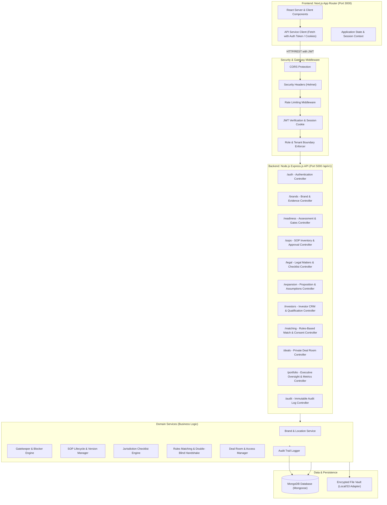

# System Architecture & Technical Design
## Franchise Development & Expansion Brokerage Platform

### 1. System Architecture Overview

The platform uses a decoupled, clean-architecture multi-tier design:
1. **Frontend Tier (Next.js & React, TypeScript)**: Server-side rendered pages and reactive client components using Next.js App Router (`apps/web`), styled with Tailwind CSS, integrating clean UI states (loading, empty, error, confirmation modals).
2. **Backend API Tier (Node.js & Express.js, TypeScript)**: Modular RESTful API server (`apps/api`), structured into Controller-Service-Repository patterns with centralized error handling, request validation, authentication, and role-based access control.
3. **Data Tier (MongoDB & Mongoose)**: Document-oriented database with schema validation, compound indexes for querying brands, matches, deals, and audit logs.
4. **Document / Evidence Vault**: Secured storage layer with authenticated streaming and access logging.



---

### 2. Frontend Structure (`apps/web`)

```text
apps/web/
├── app/
│   ├── (auth)/
│   │   ├── login/page.tsx
│   │   └── register/page.tsx
│   ├── (dashboard)/
│   │   ├── layout.tsx                     # Global sidebar, topbar, active user profile
│   │   ├── page.tsx                       # Dashboard router / Executive Portfolio view
│   │   ├── brands/
│   │   │   ├── page.tsx                   # Brand engagements list & filters
│   │   │   ├── new/page.tsx               # Brand onboarding intake
│   │   │   └── [id]/
│   │   │       ├── page.tsx               # Brand overview & evidence register
│   │   │       ├── readiness/page.tsx     # 5-dimension scorecard & approval gates
│   │   │       ├── sops/page.tsx          # Brand SOP inventory
│   │   │       ├── legal/page.tsx         # Jurisdiction legal checklist & actions
│   │   │       ├── expansion/page.tsx     # Expansion proposition & assumptions
│   │   │       └── matching/page.tsx      # Matching investor candidates & consent
│   │   ├── sops/
│   │   │   ├── page.tsx                   # Global SOP library & review schedule
│   │   │   └── [id]/page.tsx              # SOP editor, version history & approvals
│   │   ├── legal/
│   │   │   ├── page.tsx                   # Legal workspace & counsel matter queue
│   │   │   └── [id]/page.tsx              # Matter details & review outcome
│   │   ├── investors/
│   │   │   ├── page.tsx                   # Investor CRM & qualification filters
│   │   │   ├── new/page.tsx               # Investor profile intake
│   │   │   └── [id]/page.tsx              # Investor profile, criteria & verification
│   │   ├── matches/
│   │   │   └── page.tsx                   # Active matches & double-blind consent inbox
│   │   ├── deals/
│   │   │   ├── page.tsx                   # Deal pipeline Kanban & stage tracker
│   │   │   └── [id]/page.tsx              # Private deal room (Q&A, files, milestones)
│   │   ├── reports/
│   │   │   └── page.tsx                   # Operational reports & pipeline metrics
│   │   └── settings/
│   │       └── page.tsx                   # User management, roles, audit log viewer
├── components/
│   ├── ui/                                # Button, Modal, Card, Table, Input, Select, Badge, Tooltip
│   ├── layout/                            # Sidebar, Header, Breadcrumbs, TenantBadge
│   ├── brand/                             # EvidenceModal, GapForm, GateApprovalModal
│   ├── matching/                          # MatchCard, ConsentModal, ScoreBreakdown
│   ├── deal/                              # DealStageTimeline, QnAPanel, SharedDocList
│   └── common/                            # ErrorBanner, EmptyState, LoadingSpinner, ConfirmDialog
├── lib/
│   ├── api.ts                             # Centralized Axios / Fetch HTTP client with interceptors
│   ├── auth.ts                            # Client auth token & user state utilities
│   └── formatters.ts                      # Currency, date, and status formatters
└── types/                                 # Shared TypeScript interfaces for API models
```

---

### 3. Backend Structure (`apps/api`)

```text
apps/api/
├── src/
│   ├── config/
│   │   ├── database.ts                    # MongoDB connection with retry & options
│   │   ├── env.ts                         # Validated environment variables (Zod)
│   │   └── constants.ts                   # Role definitions, stages, jurisdictions
│   ├── controllers/
│   │   ├── auth.controller.ts             # Login, register, profile, session check
│   │   ├── brand.controller.ts            # Brand CRUD, locations, evidence, gaps
│   │   ├── readiness.controller.ts        # Assessments, gate approvals, blockers
│   │   ├── sop.controller.ts              # SOP inventory, versioning, review actions
│   │   ├── legal.controller.ts            # Legal matters, checklists, counsel signoffs
│   │   ├── expansion.controller.ts        # Expansion propositions, financial assumptions
│   │   ├── investor.controller.ts         # Investor CRM, qualification, preferences
│   │   ├── matching.controller.ts         # Match evaluation, consent handshake
│   │   ├── deal.controller.ts             # Deal pipeline, deal rooms, documents, Q&A
│   │   ├── portfolio.controller.ts        # Portfolio dashboard analytics & KPIs
│   │   └── audit.controller.ts            # Audit trail queries & exports
│   ├── middlewares/
│   │   ├── auth.middleware.ts             # JWT extraction and user hydration
│   │   ├── rbac.middleware.ts             # Role-based and ownership permission checks
│   │   ├── validation.middleware.ts       # Request schema validation (Zod/Joi)
│   │   ├── upload.middleware.ts           # Multipart form upload with type validation
│   │   └── error.middleware.ts            # Centralized exception handler
│   ├── models/
│   │   ├── user.model.ts                  # User accounts, hashed passwords, roles
│   │   ├── brand.model.ts                 # Brand profile, locations, assigned advisers
│   │   ├── evidence.model.ts              # Supporting evidence files & claim links
│   │   ├── readiness-gap.model.ts         # Deficiencies, owners, due dates, closure status
│   │   ├── readiness-gate.model.ts        # Approval gates (Ops, Legal, Commercial, Brand)
│   │   ├── sop.model.ts                   # Standard Operating Procedures & version history
│   │   ├── legal-matter.model.ts          # Legal matters, jurisdiction checklist, counsel reviews
│   │   ├── expansion-proposition.model.ts # Franchise model, capital breakdown, assumptions
│   │   ├── investor.model.ts              # Investor profile, criteria, verification status
│   │   ├── match.model.ts                 # Brand-investor match record, scoring, explanation
│   │   ├── consent.model.ts               # Double-blind introduction consent state
│   │   ├── deal.model.ts                  # Deal room, stage progression, milestones, Q&A
│   │   ├── shared-document.model.ts       # Deal room document disclosures & view history
│   │   └── audit-log.model.ts             # Immutable audit trail
│   ├── services/
│   │   ├── auth.service.ts
│   │   ├── brand.service.ts
│   │   ├── readiness.service.ts
│   │   ├── sop.service.ts
│   │   ├── legal.service.ts
│   │   ├── expansion.service.ts
│   │   ├── investor.service.ts
│   │   ├── matching.service.ts
│   │   ├── deal.service.ts
│   │   └── audit.service.ts
│   ├── utils/
│   │   ├── logger.ts                      # Structured logging
│   │   ├── password.ts                    # Argon2 / bcrypt hashing
│   │   └── token.ts                       # JWT creation & verification
│   ├── app.ts                             # Express application assembly
│   └── server.ts                          # Server listener & bootstrap
```

---

### 4. Authentication, Security & Tenant Isolation Flow

1. **Authentication**:
   - Passwords hashed using `bcrypt` (12 rounds).
   - Session tokens delivered as `HttpOnly`, `SameSite=Strict`, `Secure` cookies or Bearer Authorization header for cross-domain API compatibility.
   - JWT payload contains `{ userId, email, role, brandId, assignedMatters }`.
2. **Role-Based Access Control (RBAC)**:
   - System validates both **global role** (e.g. `brokerage_admin`, `sop_specialist`) and **resource-level ownership** (`req.user.brandId === req.params.brandId` for `brand_owner`).
   - `external_counsel` is restricted exclusively to endpoints matching `/api/v1/legal/matters/:matterId` where the counsel is assigned.
   - `investor` can only access `/api/v1/investors/me`, public/teaser opportunities, and private deal rooms to which their `investorId` is invited.
3. **Double-Blind Matching & Consent Handshake**:
   - Matching evaluates criteria: Sector, Investment Range, Geography/Cities, Operator Role, Unit Capacity.
   - Until **both** Brand and Investor consent:
     - Investor view contains: Brand Sector, State/City, Franchise Model, Investment Required, anonymized Brand Code (e.g. `OPP-2026-081`).
     - Brand view contains: Investor Experience Sector, Capital Bracket, Preferred Cities, anonymized Investor Code (e.g. `INV-2026-042`).
   - When both parties submit digital consent, status becomes `MUTUAL_CONSENT_GRANTED`, generating a `DealRoom` record, unmasking contact information only inside that room, and logging the event in `audit_logs`.

---

### 5. Document & Evidence Storage Strategy

1. **Development Environment**:
   - Multipart file uploads validated via Multer (strict whitelist: `.pdf`, `.docx`, `.xlsx`, `.png`, `.jpg`).
   - Stored in a secured local directory (`apps/api/uploads`) outside the public web server root.
2. **Production Environment**:
   - Pluggable storage provider interface (`StorageAdapter`) supporting S3 / Google Cloud Storage signed URLs.
   - Files are never publicly addressable. All reads require an authenticated GET request with permission check:
     - `GET /api/v1/documents/:id/download`
     - Validates role/tenant access -> Logs view event in `audit_logs` -> Streams file or issues signed 15-minute expiring link.
