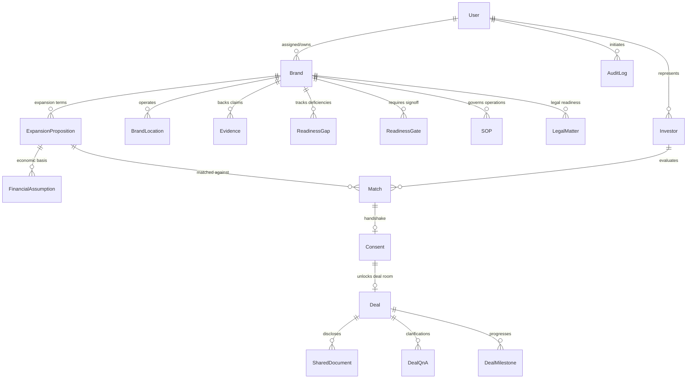

# Database Design & MongoDB Schema Specification
## Franchise Development & Expansion Brokerage Platform

### 1. Architectural Strategy
The platform utilizes MongoDB with Mongoose ODM for type safety, validation, and lifecycle hooks. The schema is designed around business entities reflecting the three connected workstreams: Brand Readiness, Legal & SOP Preparation, and Qualified Investor Introductions.

---

### 2. Core Collections & Entity Relationship Diagram



---

### 3. Detailed Schema Definitions

#### 3.1 `users`
Represents all system actors with role-based attributes.
```typescript
interface IUser {
  _id: ObjectId;
  name: string;
  email: string;              // unique, indexed
  passwordHash: string;
  role: 'brokerage_admin' | 'franchise_adviser' | 'sop_specialist' | 'brand_owner' | 'external_counsel' | 'investor' | 'platform_admin';
  brandId?: ObjectId;         // set if role === 'brand_owner'
  investorId?: ObjectId;      // set if role === 'investor'
  phone?: string;
  organization?: string;
  isActive: boolean;
  lastLoginAt?: Date;
  createdAt: Date;
  updatedAt: Date;
}
```
*Indexes:* `{ email: 1 }` (unique), `{ role: 1 }`, `{ brandId: 1 }`.

#### 3.2 `brands`
The central franchise candidate organization.
```typescript
interface IBrand {
  _id: ObjectId;
  name: string;
  legalEntity: string;
  sector: 'Food & Beverage' | 'Retail' | 'Health & Wellness' | 'Education' | 'Services' | 'Automotive' | 'Other';
  subSector?: string;
  operatingSince: Date;
  headquarters: {
    city: string;
    state: string;
    country: string; // Defaults to 'India'
  };
  contactPerson: {
    name: string;
    title: string;
    email: string;
    phone: string;
  };
  assignedAdviserId: ObjectId; // ref: 'User'
  status: 'intake' | 'assessment_in_progress' | 'gaps_remediation' | 'ready_for_review' | 'approved_for_outreach' | 'paused' | 'archived';
  readinessSummary: {
    operationsScore?: number; // 0-100 reference
    economicsScore?: number;
    brandIpScore?: number;
    managementScore?: number;
    legalScore?: number;
    overallStatus: 'not_ready' | 'conditional' | 'franchise_ready';
  };
  confidentialitySettings: {
    blindedName: string; // e.g. "Specialty Coffee Brand - Mumbai"
    hideIdentityUntilConsent: boolean; // defaults to true
  };
  createdAt: Date;
  updatedAt: Date;
}
```
*Indexes:* `{ status: 1 }`, `{ assignedAdviserId: 1 }`, `{ sector: 1 }`.

#### 3.3 `brand_locations` (Outlets)
Records operational proof of unit-level viability (`BR-02`).
```typescript
interface IBrandLocation {
  _id: ObjectId;
  brandId: ObjectId; // ref: 'Brand'
  name: string;
  address: string;
  city: string;
  state: string;
  format: 'Dine-In Flagship' | 'QSR / Express' | 'Kiosk' | 'Cloud Kitchen' | 'Retail Store';
  openingDate: Date;
  status: 'operating' | 'under_renovation' | 'closed';
  monthlyAverageRevenue?: number;
  monthlyAverageEbitda?: number;
  hasPerformanceEvidence: boolean;
  evidenceFileId?: ObjectId; // ref: 'Evidence'
  createdAt: Date;
}
```
*Indexes:* `{ brandId: 1 }`, `{ city: 1 }`.

#### 3.4 `evidence` (Brand & Investor Evidence Vault)
Links claims to verifiable records with human verification status (`BR-03`, `BR-04`).
```typescript
interface IEvidence {
  _id: ObjectId;
  entityType: 'brand' | 'investor';
  entityId: ObjectId;
  claim: string;             // e.g. "Trademark registration granted in Class 43"
  category: 'financial' | 'legal_ip' | 'operations' | 'management' | 'compliance';
  fileName: string;
  fileUrl: string;
  fileSizeBytes: number;
  mimeType: string;
  uploadedBy: ObjectId;      // ref: 'User'
  confidentialityLevel: 'public' | 'internal_only' | 'deal_room_only' | 'strictly_confidential';
  verificationStatus: 'self_reported' | 'supported_by_evidence' | 'reviewed_by_adviser' | 'unresolved';
  verifiedBy?: ObjectId;     // ref: 'User'
  verifiedAt?: Date;
  notes?: string;
  createdAt: Date;
}
```
*Indexes:* `{ entityId: 1, entityType: 1 }`, `{ verificationStatus: 1 }`.

#### 3.5 `readiness_gaps` & `readiness_gates`
Tracks deficiencies and blocks premature investor release (`BR-05`, `RA-02`, `RA-03`).
```typescript
interface IReadinessGap {
  _id: ObjectId;
  brandId: ObjectId;
  dimension: 'operating_repeatability' | 'unit_economics' | 'brand_ip' | 'management_capacity' | 'legal_preparation';
  title: string;
  description: string;
  severity: 'critical' | 'high' | 'medium' | 'low';
  assignedTo: ObjectId;      // ref: 'User'
  dueDate: Date;
  status: 'open' | 'in_progress' | 'closed';
  closureNotes?: string;
  closedBy?: ObjectId;       // ref: 'User'
  closedAt?: Date;
  createdAt: Date;
}

interface IReadinessGate {
  _id: ObjectId;
  brandId: ObjectId;
  gateType: 'operations_gate' | 'commercial_gate' | 'legal_gate' | 'brand_owner_gate';
  status: 'pending' | 'approved' | 'rejected';
  approverId?: ObjectId;     // ref: 'User'
  approvedAt?: Date;
  comments?: string;
  blockingReasons: string[];
}
```
*Indexes:* `{ brandId: 1, status: 1 }`.

#### 3.6 `sops` (Standard Operating Procedures)
Codification of operational knowledge (`SOP-01` to `SOP-06`).
```typescript
interface ISOP {
  _id: ObjectId;
  brandId: ObjectId;
  code: string;              // e.g. "SOP-OPS-001"
  title: string;
  category: 'Opening & Closing' | 'Food Safety & Hygiene' | 'Inventory & Procurement' | 'Customer Service' | 'Staff Training' | 'Quality Control';
  outletFormat: string[];
  ownerId: ObjectId;         // ref: 'User'
  currentVersion: string;    // e.g. "1.2.0"
  status: 'draft' | 'in_review' | 'approved' | 'superseded';
  contentMarkdown?: string;
  fileAttachmentUrl?: string;
  effectiveDate?: Date;
  nextReviewDate?: Date;
  approvedBy?: ObjectId;
  approvedAt?: Date;
  versionHistory: Array<{
    version: string;
    contentSummary: string;
    changedBy: ObjectId;
    changedAt: Date;
    approvalNotes?: string;
  }>;
  createdAt: Date;
  updatedAt: Date;
}
```
*Indexes:* `{ brandId: 1, category: 1 }`, `{ status: 1 }`, `{ nextReviewDate: 1 }`.

#### 3.7 `legal_matters`
Jurisdiction-specific legal readiness management (`LEG-01` to `LEG-05`).
```typescript
interface ILegalMatter {
  _id: ObjectId;
  brandId: ObjectId;
  jurisdiction: 'India' | 'United States' | 'United Kingdom' | 'UAE' | 'Singapore';
  matterType: 'Franchise Agreement' | 'Trademark & IP' | 'Commercial Disclosure' | 'Data Protection (DPDP)' | 'Territory & Exclusivity';
  assignedCounselId?: ObjectId; // ref: 'User' (external_counsel)
  status: 'not_started' | 'in_preparation' | 'awaiting_counsel' | 'changes_requested' | 'counsel_review_recorded';
  checklist: Array<{
    itemKey: string;
    title: string;
    isMandatory: boolean;
    isCompleted: boolean;
    documentUrl?: string;
    notes?: string;
  }>;
  documents: Array<{
    title: string;
    version: string;
    fileUrl: string;
    uploadedAt: Date;
    status: 'draft' | 'under_counsel_review' | 'counsel_cleared' | 'changes_required';
  }>;
  counselReviewScope?: string;
  counselSignoffDate?: Date;
  counselNotes?: string;
  createdAt: Date;
  updatedAt: Date;
}
```
*Indexes:* `{ brandId: 1, jurisdiction: 1 }`, `{ assignedCounselId: 1 }`, `{ status: 1 }`.

#### 3.8 `expansion_propositions` & `financial_assumptions`
Defines expansion terms and transparent economics (`EXP-01` to `EXP-05`).
```typescript
interface IExpansionProposition {
  _id: ObjectId;
  brandId: ObjectId;
  franchiseModel: 'Single-Unit Franchise' | 'Multi-Unit Development' | 'Area Development' | 'Master Franchise';
  targetGeography: {
    countries: string[];
    tier1Cities: string[];
    tier2Cities: string[];
    regions: string[];
  };
  minimumUnits: number;
  developmentPeriodMonths: number;
  fees: {
    franchiseFee: number;
    initialSetupEstimate: number;
    workingCapitalRequirement: number;
    royaltyPercentage: number;
    marketingFundPercentage: number;
    currency: string; // e.g. 'INR'
  };
  financialAssumptions: Array<{
    parameter: string;
    amount: number;
    currency: string;
    classification: 'historical_actual' | 'management_assumption' | 'projected_model';
    source: string;
    asOfDate: Date;
    verifiedByAdviser: boolean;
  }>;
  investorFacingTeaser: {
    headline: string;
    summaryDescription: string;
    keyHighlights: string[];
    targetPaybackMonths: string; // range, e.g. "24-36 months"
    isApprovedByBrandOwner: boolean;
    approvedAt?: Date;
  };
  status: 'draft' | 'internal_review' | 'brand_approved' | 'active_for_matching';
  createdAt: Date;
  updatedAt: Date;
}
```

#### 3.9 `investors`
Structured investor profiles and human-verified qualification (`INV-01` to `INV-07`).
```typescript
interface IInvestor {
  _id: ObjectId;
  userId?: ObjectId;          // linked user account for portal
  name: string;
  companyName?: string;
  email: string;              // protected until mutual consent
  phone: string;              // protected until mutual consent
  source: 'direct_referral' | 'inbound_web' | 'brokerage_network' | 'event';
  preferences: {
    targetSectors: string[];
    preferredLocations: string[];
    minBudget: number;
    maxBudget: number;
    currency: string;
    targetTimingMonths: number;
  };
  capability: {
    intendedRole: 'hands_on_operator' | 'multi_unit_operator' | 'area_developer' | 'master_franchisee' | 'passive_investor';
    maxUnitsCapacity: number;
    existingOperatingExperienceYears: number;
    sectorExperienceSummary: string;
  };
  qualification: {
    financialReviewStatus: 'unverified' | 'in_review' | 'verified_by_adviser' | 'rejected';
    verifiedBy?: ObjectId;
    verifiedAt?: Date;
    qualificationNotes?: string;
  };
  assignedAdviserId: ObjectId;
  status: 'active' | 'evaluating' | 'engaged_in_deal' | 'withdrawn';
  createdAt: Date;
  updatedAt: Date;
}
```
*Indexes:* `{ status: 1 }`, `{ 'qualification.financialReviewStatus': 1 }`, `{ 'preferences.targetSectors': 1 }`.

#### 3.10 `matches` & `consents`
Rules-based evaluation and double-blind mutual handshake (`MAT-01` to `MAT-06`).
```typescript
interface IMatch {
  _id: ObjectId;
  brandId: ObjectId;
  expansionPropositionId: ObjectId;
  investorId: ObjectId;
  adviserReviewStatus: 'pending_adviser' | 'adviser_approved' | 'adviser_rejected';
  rejectionReason?: string;
  matchScore: number;         // 0 - 100 transparent rules score
  criteriaBreakdown: {
    sectorMatch: boolean;
    budgetMatch: boolean;
    geographyMatch: boolean;
    roleCapacityMatch: boolean;
    unmetCriteria: string[];
    missingInfo: string[];
  };
  adviserNotes?: string;
  createdAt: Date;
}

interface IConsent {
  _id: ObjectId;
  matchId: ObjectId;
  brandId: ObjectId;
  investorId: ObjectId;
  propositionPackVersion: string;
  brandConsent: {
    status: 'pending' | 'granted' | 'declined';
    consentedAt?: Date;
    consentedBy?: ObjectId;
  };
  investorConsent: {
    status: 'pending' | 'granted' | 'declined';
    consentedAt?: Date;
    consentedBy?: ObjectId;
  };
  overallStatus: 'pending' | 'mutual_consent_granted' | 'declined';
  dealRoomId?: ObjectId;     // ref: 'Deal'
  createdAt: Date;
  updatedAt: Date;
}
```
*Indexes:* `{ brandId: 1, investorId: 1 }` (unique compound), `{ overallStatus: 1 }`.

#### 3.11 `deals`, `shared_documents`, `deal_qna`
Private deal room created exclusively after mutual consent (`DEAL-01` to `DEAL-06`).
```typescript
interface IDeal {
  _id: ObjectId;
  consentId: ObjectId;
  brandId: ObjectId;
  investorId: ObjectId;
  dealCode: string;          // e.g. "DEAL-2026-009"
  stage: 'introduction_approved' | 'initial_meeting' | 'due_diligence' | 'terms_negotiation' | 'agreement_review' | 'closed_won' | 'closed_lost' | 'paused';
  assignedAdviserId: ObjectId;
  participants: Array<{
    userId: ObjectId;
    role: 'brokerage' | 'brand' | 'investor' | 'legal';
    addedAt: Date;
  }>;
  milestones: Array<{
    name: string;
    targetDate: Date;
    completedAt?: Date;
    completed: boolean;
  }>;
  nextAction: {
    description: string;
    assignedToRole: 'brokerage' | 'brand' | 'investor';
    dueDate: Date;
  };
  outcomeReason?: string;
  closedAt?: Date;
  createdAt: Date;
  updatedAt: Date;
}

interface ISharedDocument {
  _id: ObjectId;
  dealId: ObjectId;
  title: string;
  documentType: 'legal_pack' | 'financial_model' | 'sop_overview' | 'term_sheet';
  version: string;
  fileUrl: string;
  accessRule: 'mutual_parties_only' | 'legal_only';
  sharedBy: ObjectId;
  accessLogs: Array<{
    userId: ObjectId;
    action: 'view' | 'download';
    timestamp: Date;
    ipAddress?: string;
  }>;
  createdAt: Date;
}

interface IDealQnA {
  _id: ObjectId;
  dealId: ObjectId;
  question: string;
  askedBy: ObjectId;         // ref: 'User'
  category: 'financial' | 'operational' | 'territory' | 'legal';
  assignedTo: ObjectId;      // ref: 'User'
  status: 'open' | 'answered' | 'closed';
  answer?: string;
  answeredBy?: ObjectId;
  answeredAt?: Date;
  createdAt: Date;
}
```

#### 3.12 `audit_logs`
Immutable record of all state transitions, approvals, views and consents (`OPS-05`).
```typescript
interface IAuditLog {
  _id: ObjectId;
  actorId: ObjectId;         // ref: 'User'
  actorRole: string;
  action: string;            // e.g. 'GATE_APPROVED', 'MUTUAL_CONSENT_GRANTED', 'DOC_ACCESSED'
  targetEntity: 'brand' | 'sop' | 'legal_matter' | 'investor' | 'match' | 'deal' | 'document';
  targetId: ObjectId;
  previousState?: any;
  newState?: any;
  reason?: string;
  ipAddress?: string;
  userAgent?: string;
  timestamp: Date;
}
```
*Indexes:* `{ targetEntity: 1, targetId: 1 }`, `{ actorId: 1 }`, `{ timestamp: -1 }`.
